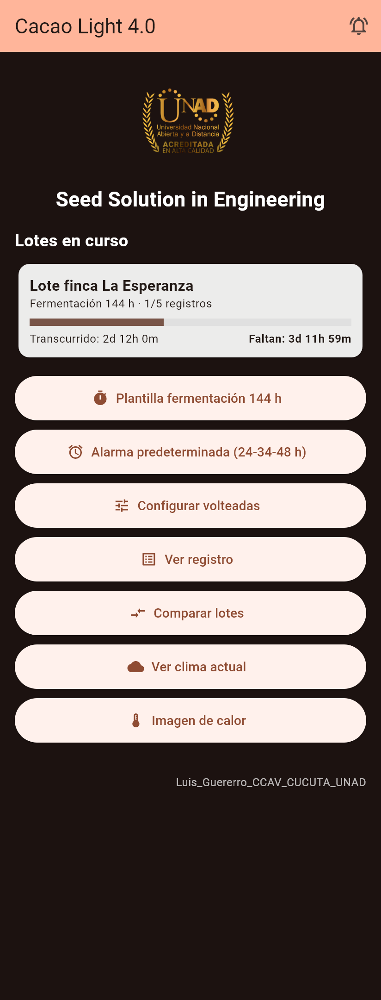

# Cacao Light 4.0

Aplicación Android (Flutter) para pequeños productores de cacao (Chinácota y Durania, Norte de Santander)
que acompaña el **beneficio del cacao**: programa las alarmas de volteo y los recordatorios de medir, registra
temperatura, humedad, pH, Brix y observaciones, dibuja la curva del lote, marca el punto de secado con GPS, muestra
el clima, responde dudas con una guía verificada (con o sin internet) y, con internet, con una inteligencia artificial.

Proyecto de Luis Guerrero (CCAV Cúcuta, UNAD): entrega de Proyecto de Ingeniería II y de la ruta de Investigadores.

**Principio de diseño: sin internet primero.** Todo lo esencial (alarmas, registros, curva, guía, glosario, respaldo)
funciona sin señal. Lo que necesita servidor (chat con IA, análisis de fotos, nombre exacto del lugar, clima) se suma
cuando hay señal.

> **Estado honesto:** la app **no se ha probado en un teléfono Android real**, el servidor **no está desplegado** y
> nada se ha probado contra la API real de Anthropic. Ningún técnico ni productor ha revisado aún los textos de las
> guías. Ver `docs/calidad.md` para lo que sí se midió y lo que falta.

## Capturas

| Inicio | Detalle del lote | Registro de volteada | Comparar lotes |
|---|---|---|---|
|  |  |  |  |

> Las capturas se generan con las pantallas reales de la app y datos de ejemplo
> (`flutter test test_capturas --update-goldens`). El fondo de video de la
> pantalla de inicio no aparece en ellas.

## Qué hace

| Función | Dónde está | ¿Sin internet? |
|---|---|---|
| Alarmas de volteo y fin de ciclo (plantilla FEDECACAO de 144 h, la original y horas propias) | `lib/services/alarm_scheduler.dart`, `plantillas.dart` | Sí |
| Recordatorios de medir la temperatura cada 12 h (con interruptor) y red de seguridad que reprograma alarmas perdidas | `recordatorio_service.dart`, `plan_recordatorios.dart` | Sí |
| Registro por volteada: temperatura, humedad, pH, Brix, temperatura ambiente, observación (con dictado por voz opcional) | `confirmar_volteada_screen.dart`, `widgets/boton_dictado.dart` | Sí (el dictado depende del servicio de voz del teléfono) |
| Reglas de alerta editables, con su fuente (p. ej. 45 °C desde la hora 48) | `reglas_alerta.dart` | Sí |
| Curva del lote con banda fuera de rango, curva ideal propia, comparar dos lotes, exportar PNG, PDF y CSV | `curva_lote_chart.dart`, `curva_ideal.dart`, `exportar_curva.dart` | Sí |
| Guía ilustrada de la prueba de corte | `guia_prueba_corte_screen.dart` | Sí |
| Punto de secado por GPS (espera hasta 30 s, usa la última ubicación conocida y lo avisa) | `location_service.dart` | Sí |
| Nombre del lugar: sin internet, el municipio o centro poblado más cercano del DANE; con internet, el servidor | `lugares_offline.dart`, `lugar_service.dart` | Sí (aproximado) |
| Clima con Open-Meteo, con entrada manual si no hay señal | `clima_service.dart`, `clima_screen.dart` | Parcial (entrada manual) |
| Chat con guía verificada: respuestas locales sin internet; con internet, IA con citas de la guía | `chat_service.dart`, `buscador_conocimiento.dart`, `assets/conocimiento/` | Sí (guía local) |
| Análisis de foto con IA (con cola si no hay señal) | `foto_service.dart`, `fotos_lote_screen.dart` | Se guarda y se envía luego |
| Glosario y guía rápida | `ayuda_screen.dart` | Sí |
| Ajustes: letra grande, alto contraste, ahorro de batería, autorizaciones | `ajustes_screen.dart`, `tema_app.dart` | Sí |
| Copia de seguridad (exportar e importar un archivo) y "Borrar todos mis datos" | `copia_seguridad.dart`, `borrar_datos.dart` | Sí |
| Política de privacidad y créditos dentro de la app | `politica_screen.dart`, `creditos_screen.dart` | Sí |

### Sobre la plantilla de 144 horas

La duración de 144 h (6 días) es la que reporta FEDECACAO; pasar de 144 h se considera sobrefermentación. La pauta de
volteo 48-24-24-24 viene de tesis de la UIS y de la UNAD; **no** se encontró un documento oficial de FEDECACAO con esa
pauta exacta. Las horas están en una sola constante (`Plantillas.fedecacao144`). Los rangos de la curva (fermentación
45-50 °C según FHIA 2017, secado tope 50 °C) están en `lib/data/referencias_curva.dart` con su fuente en
`docs/fuentes-curva.md`.

## Arquitectura

```
App Android (Flutter, SQLite local)                Servidor (backend/, Vercel, TypeScript)
┌──────────────────────────────────────┐   HTTPS   ┌───────────────────────────────────────┐
│ pantallas ─ servicios ─ SQLite       │──────────▶│ POST /chat          → Claude Haiku 5.5 │
│ alarmas del sistema (sin servidor)   │           │ POST /analizar-foto → Claude Sonnet 5.5│
│ guía verificada (assets, offline)    │           │ POST /lugar         → Nominatim (caché)│
└──────────────────────────────────────┘           │ límites por instalación/IP/día,        │
        │ HTTPS (sin clave)                        │ tope de gasto diario, almacén Upstash  │
        ▼                                          └───────────────────────────────────────┘
   Open-Meteo (clima)
```

- La app **no lleva ninguna clave**. La clave de Anthropic vive solo en el servidor.
- El servidor no guarda preguntas ni fotos; solo registra códigos y números (`docs/backend-seguridad.md`).
- Contexto que sale hacia la IA: etapa, horas y hasta 8 registros. Nunca el nombre del lote ni la ubicación.

```
lib/
  data/          SQLite (versión 7), guía verificada, referencias de la curva, créditos, política
  models/        Lote, Volteada (registro), análisis de foto, mensajes
  services/      Alarmas, notificaciones, lotes, GPS, clima, chat, fotos, respaldo, borrado
  screens/       Pantallas        widgets/   Piezas reutilizables
backend/         Servidor (ver backend/README.md)
assets/conocimiento/  Base de conocimiento con 61 citas literales (tool/verificar_conocimiento.py)
docs/            Documentación (calidad, privacidad, créditos, costos, seguridad, fuentes)
test/            Pruebas de la app        backend/test/   Pruebas del servidor
```

## Instalación

### Requisitos

- Flutter estable (desarrollo con **Flutter 3.38.9 / Dart 3.10.8**) y Android SDK (compileSdk 36), **JDK 17**.
- Teléfono con Android 7.0 (API 24) o superior (`minSdk = flutter.minSdkVersion` = 24 en esta versión de Flutter).
- Para el servidor: Node.js LTS.

### Pasos

```bash
git clone https://github.com/Luisduran12/Alarma-de-cacao.git
cd Alarma-de-cacao
flutter pub get
flutter run                      # teléfono conectado; no hace falta ninguna clave
# Con servidor (opcional): la dirección no es un secreto
flutter run --dart-define=BACKEND_URL=https://tu-servidor.vercel.app
```

## Variables de entorno

La **app** solo usa `BACKEND_URL` (con `--dart-define`). Si falta, el chat con IA, el análisis de fotos y el nombre
exacto del lugar quedan apagados y la app sigue funcionando.

El **servidor** (`backend/`, se configuran en Vercel; **nunca** en un archivo del repositorio):

| Variable | Para qué |
|---|---|
| `ANTHROPIC_API_KEY` | Clave de Anthropic (con tope de gasto en su consola). |
| `ID_PEPPER` | Secreto para anonimizar el ID de instalación y la IP antes de contar consultas. |
| `NOMINATIM_CONTACTO` | Contacto que pide la política de uso de Nominatim. |
| `UPSTASH_REDIS_REST_URL`, `UPSTASH_REDIS_REST_TOKEN` (o `KV_REST_API_URL`, `KV_REST_API_TOKEN`) | Almacén de contadores. Sin él, el servidor rechaza todo (falla cerrado). |
| `PRESUPUESTO_DIARIO_USD` | Tope de gasto diario (5 por defecto). |
| `LIMITE_CHAT_DIA`, `LIMITE_FOTO_DIA`, `LIMITE_LUGAR_DIA`, `LIMITE_IP_HORA` | Límites de uso (opcionales). |
| `MODELO_CHAT`, `MODELO_FOTO` | Cambiar de modelo (opcional). |
| `REFERENCIAS_POR_CLASE` | Ejemplos de referencia por clase en el análisis de fotos (0 a 5; 0 por defecto). |
| `BLOQUEO_TOTAL=1`, `LUGAR_DESACTIVADO=1` | Interruptores de emergencia. |

Despliegue, contrato de las rutas y límites: `backend/README.md`. Costos estimados: `docs/costos-ia.md`.

## Pruebas y cobertura

```bash
flutter test                     # pruebas de la app
flutter test --coverage          # informe en coverage/lcov.info
cd backend && npm install && npm test
```

Al 2026-11-18: **625 pruebas de la app** y **241 del servidor**, todas pasan; `flutter analyze lib test` da 4 avisos
informativos (APIs obsoletas y estilo) y ningún error. Cobertura de líneas de la app: **81,4 %** (3.749 de 4.605 líneas
de los 81 archivos que las pruebas cargan; `lib/app.dart` y `lib/utils/csv_utils.dart` no los carga ninguna prueba).
Las pruebas de accesibilidad (`test/accesibilidad_*`) usan las guías de Flutter; **no reemplazan probar con TalkBack**.
En cada `push` corre GitHub Actions (`.github/workflows/ci.yml`).

Para probar las alarmas en un teléfono, el ícono de campana de la pantalla principal ("Probar alarma") suena a los 10 segundos.

## Compilar el APK de release

```bash
flutter build apk --release      # build/app/outputs/flutter-apk/app-release.apk
```

### Firma

La firma se lee de `android/key.properties` (en `.gitignore`, **nunca se sube**):

```properties
storePassword=...
keyPassword=...
keyAlias=cacaolight
storeFile=/ruta/a/cacaolight-release.jks
```

Sin ese archivo el APK se firma con la clave de debug (sirve para probar; Google Play no la acepta). **Guarde la
keystore y sus contraseñas en un lugar seguro y con copia:** sin ellas no se pueden publicar actualizaciones. El
identificador de la app es `com.luisduran.cacaolight` y no se puede cambiar una vez publicada.

## Permisos que pide

| Permiso | Para qué |
|---|---|
| Notificaciones (`POST_NOTIFICATIONS`) | Mostrar las alarmas. |
| Alarmas exactas (`SCHEDULE_EXACT_ALARM`) | Que suene a la hora exacta (si no se concede, queda aproximada). |
| Reinicio (`RECEIVE_BOOT_COMPLETED`) | Reprogramar las alarmas tras reiniciar. |
| Ubicación **solo mientras se usa** la app | Clima y punto de secado. Solo después de que el productor lo autoriza dentro de la app. |
| Micrófono (`RECORD_AUDIO`) | Dictado por voz, opcional y con autorización previa. |
| Internet | Chat, fotos, lugar y clima. |

## Privacidad y créditos

Política (Ley 1581 de 2012): `docs/privacidad.md` y dentro de la app (Ajustes). Lo que usa de terceros y sus licencias:
`docs/creditos.md`. Anthropic puede conservar lo que recibe por la API hasta 30 días. La clave de OpenWeatherMap que
estuvo en el primer commit (`cb55257`) quedó expuesta en el historial público: debe revocarse; la app ya no la usa.

## Trabajo pendiente

- Probar en teléfonos Android reales (alarmas con la app cerrada y tras reiniciar, GPS, cámara, TalkBack).
- Desplegar el servidor y medir el acierto de la IA con fotos locales clasificadas por un técnico (carpeta `evaluacion/colombia/`).
- Que un técnico revise los textos de las guías; validar la pauta de volteo con el protocolo vigente de FEDECACAO.
- Validación de usabilidad con 3 a 5 productores: el material está en `docs/validacion/` (plantillas vacías); la validación **todavía no se ha hecho**.
- Play Integrity no está implementado (`docs/backend-seguridad.md`).
