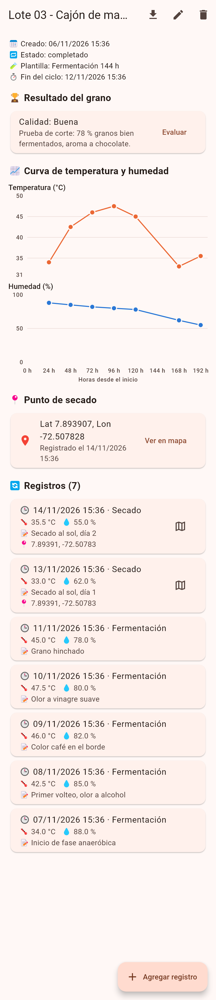
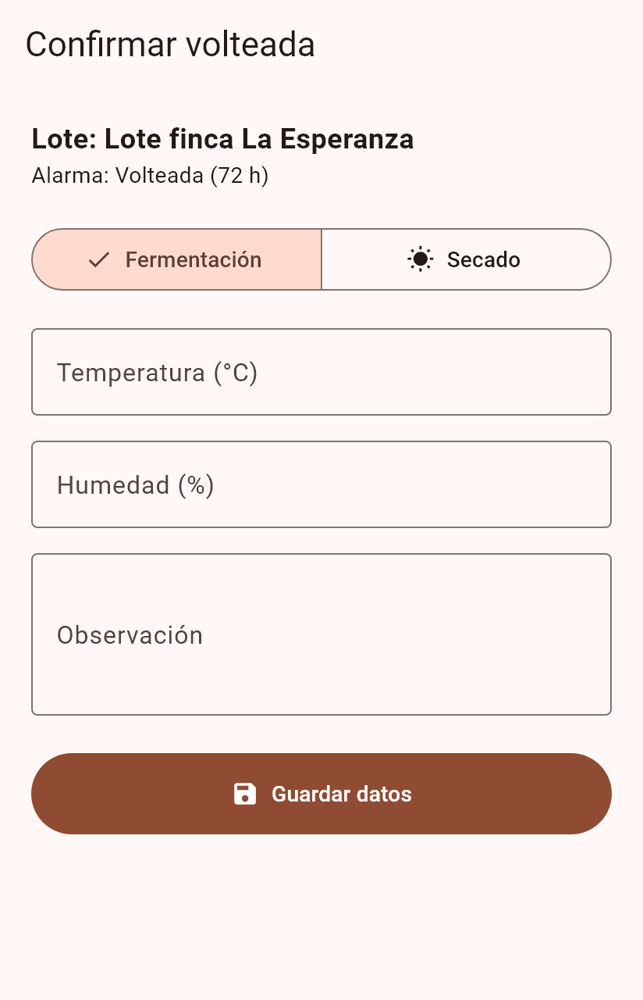
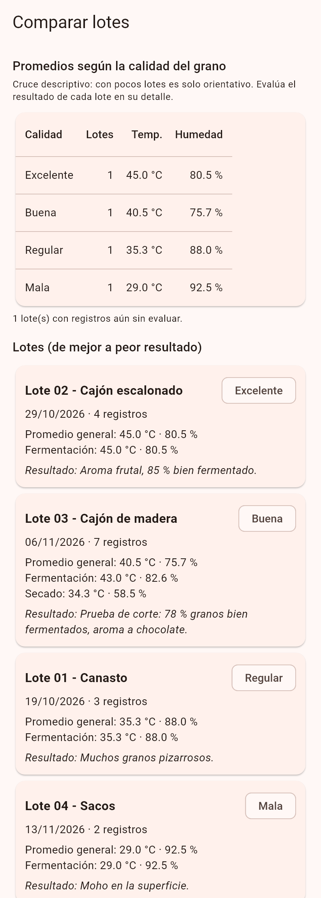

# Cacao Light 4.0

Aplicación Android (Flutter) para acompañar el **beneficio del cacao**: programa
las alarmas de volteo de la fermentación, registra temperatura, humedad y
observaciones en cada volteada, marca el punto de secado con GPS y permite
comparar lotes para ver qué condiciones dieron mejor grano.

Proyecto de Luis Guerrero (CCAV Cúcuta, UNAD).

## Capturas

| Inicio | Detalle del lote | Registro de volteada | Comparar lotes |
|---|---|---|---|
|  |  |  |  |

> Las capturas se generan con las pantallas reales de la app y datos de ejemplo
> (`flutter test test_capturas --update-goldens`). El fondo de video de la
> pantalla de inicio no aparece en ellas.

## Qué hace

| Función | Dónde está | ¿Funciona con la app cerrada / sin internet? |
|---|---|---|
| **Alarmas de volteo** programadas en el sistema (`zonedSchedule`), con sonido propio. Al tocarlas se abre el formulario de esa volteada. | `lib/services/alarm_scheduler.dart`, `notification_service.dart` | Sí suenan con la app cerrada y después de reiniciar el teléfono. No necesitan internet. |
| **Plantilla de fermentación de 144 h** (volteos a las 48, 72, 96 y 120 h; fin a las 144 h), la predeterminada original (24-34-48 h) y horas personalizadas. | `lib/services/plantillas.dart` | Sí. |
| **Registro por volteada**: temperatura, humedad, observación y etapa (fermentación o secado). | `lib/screens/confirmar_volteada_screen.dart` | Sin internet, sí. |
| **Punto de secado**: latitud y longitud guardadas con el registro de secado y mostradas en el detalle del lote ("Ver en mapa"). | mismo formulario y `detalle_lote_screen.dart` | El GPS funciona sin internet; abrir el mapa sí lo necesita. |
| **Historial por lote** en una base de datos local **SQLite** (`sqflite`). | `lib/data/`, `lib/services/lote_service.dart` | Sí, todo es local. |
| **Curva de temperatura y humedad** de cada lote en el tiempo (`fl_chart`). | `lib/widgets/curva_lote_chart.dart` | Sí. |
| **Barra de progreso del ciclo**, calculada desde la hora de inicio guardada (no vuelve a 0 al cerrar la app). | `lib/widgets/timer_progress_bar.dart` | Sí. |
| **Comparación entre lotes**: temperatura y humedad promedio de cada lote junto con la calidad del grano y la observación del resultado; promedios por calidad. | `lib/screens/comparacion_lotes_screen.dart`, `lib/services/analisis_lotes.dart` | Sí. |
| **Clima actual** por GPS (OpenWeatherMap) y evaluación para fermentar o secar. | `lib/services/clima_service.dart`, `evaluador_cacao.dart` | Necesita internet y la clave de la API. |
| **Exportar a CSV** (un lote o todos). | `detalle_lote_screen.dart`, `lib/utils/export_utils.dart` | Sí. |

### Sobre la plantilla de 144 horas

La duración de 144 h (6 días) es la que reporta FEDECACAO; pasar de 144 h se
considera sobrefermentación. La pauta de volteo **48-24-24-24** (primer volteo a
las 48 h y luego cada 24 h) viene de tesis de la UIS y de la UNAD sobre
fermentación en Colombia; **no** se encontró un documento oficial de FEDECACAO
con esa pauta exacta. FEDECACAO también ha descrito volteos cada 4 h durante los
4 días posteriores a la fase anaeróbica. Las horas están en una sola constante
(`Plantillas.fedecacao144`) para ajustarlas al protocolo de cada asociación.

### Sobre la comparación de lotes

Es un **cruce descriptivo de promedios**: muestra qué temperatura y humedad
tuvieron los lotes según la calidad que obtuvieron. Con pocos lotes es solo
orientativo; no es un modelo estadístico.

## Instalación

### Requisitos

- Flutter 3.32 o superior (probado con **Flutter 3.50.0 / Dart 3.14**).
- Android SDK (compileSdk 36) y **JDK 17**.
- Un teléfono Android 6.0 (API 23) o superior.

### Pasos

```bash
git clone https://github.com/Luisduran12/Alarma-de-cacao.git
cd Alarma-de-cacao
flutter pub get

# 1. Configurar las claves (ver la sección siguiente)
cp .env.example .env      # y edita .env

# 2. Ejecutar en un teléfono conectado
flutter run --dart-define-from-file=.env
```

## Configurar las claves

La app **no** lleva claves dentro del código. Se pasan al compilar desde el
archivo `.env`, que está en `.gitignore` y nunca se sube a GitHub:

```env
# .env
OPENWEATHER_API_KEY=tu_clave_de_openweathermap
```

- Obtén la clave en <https://home.openweathermap.org/api_keys>.
- Compila siempre con `--dart-define-from-file=.env`. Sin la clave, la app
  funciona normalmente y solo la pantalla de clima muestra un aviso.
- Ojo: lo que se pasa con `--dart-define` queda dentro del APK. Para una clave
  gratuita de clima es aceptable; **una clave de pago (por ejemplo, de IA) debe
  ir en un backend, nunca en la app**.

> La clave que estuvo en el primer commit (`cb55257`) quedó expuesta en el
> historial público y debe darse por comprometida: hay que anularla en
> OpenWeatherMap.

## Compilar el APK de release

```bash
flutter build apk --release --dart-define-from-file=.env
# Resultado: build/app/outputs/flutter-apk/app-release.apk
```

### Firma del APK de release

La firma se lee de `android/key.properties` (en `.gitignore`):

```properties
storePassword=...
keyPassword=...
keyAlias=cacaolight
storeFile=C:/ruta/a/cacaolight-release.jks
```

Si el archivo no existe, el APK se firma con la clave de debug (sirve para
probar, pero Google Play no la acepta). Para crear una keystore propia:

```bash
keytool -genkeypair -keystore cacaolight-release.jks -alias cacaolight \
  -keyalg RSA -keysize 2048 -validity 10000
```

**Guarda la keystore y sus contraseñas en un lugar seguro**: sin ellas no se
pueden publicar actualizaciones de la app.

## Permisos que pide

| Permiso | Para qué |
|---|---|
| Notificaciones (`POST_NOTIFICATIONS`) | Mostrar las alarmas de volteo. |
| Alarmas exactas (`SCHEDULE_EXACT_ALARM`) | Que la alarma suene a la hora exacta. Si no se concede, se programa una alarma aproximada. |
| Reinicio (`RECEIVE_BOOT_COMPLETED`) | Volver a programar las alarmas después de reiniciar el teléfono. |
| Ubicación **mientras se usa la app** | Clima de la zona y punto de secado. No se usa la ubicación en segundo plano. |

## Pruebas

```bash
flutter test
```

31 pruebas unitarias:

- `test/evaluador_cacao_test.dart`: evaluación del clima para fermentación y secado.
- `test/modelos_test.dart`: `toJson`/`fromJson` y filas de base de datos de `Lote` y `Volteada`.
- `test/lote_service_test.dart`: base de datos SQLite en memoria; crear lotes **sin borrar los anteriores**, confirmar volteadas sin duplicarlas, eliminar lotes y migración de los datos antiguos.
- `test/plantillas_analisis_test.dart`: plantilla de 144 h, comparación por calidad, progreso persistente y formato de las notificaciones.

Para probar las alarmas en un teléfono, usa el ícono de campana de la pantalla
principal ("Probar alarma"): suena a los 10 segundos, también con la app cerrada.

## Estructura

```
lib/
  data/          Base de datos SQLite y migración desde SharedPreferences
  models/        Lote, Volteada (registro), Etapa, Calidad
  services/      Alarmas, notificaciones, lotes, plantillas, análisis, clima, GPS
  screens/       Pantallas
  widgets/       Barra de progreso, curva, formularios
test/            Pruebas unitarias
test_capturas/   Generador de las capturas del README
docs/capturas/   Capturas
```

### Datos

Todo se guarda en `cacao_light.db` (SQLite):

- `lotes`: id, título, estado, fecha de creación, inicio y fin del ciclo, plantilla, calidad y observación del resultado.
- `registros`: volteadas programadas y datos medidos: fecha, temperatura, humedad, observación, latitud, longitud, etapa, confirmada e id de la notificación.

Las versiones anteriores guardaban los datos en tres claves de
SharedPreferences (`lotes_guardados`, `volteadas` y `lotes_data`). La primera
vez que se abre esta versión se migran a SQLite sin perder ni duplicar datos, y
las claves antiguas se conservan como respaldo.

## Trabajo futuro

- **Chat con inteligencia artificial** para resolver dudas del productor. Debe
  hacerse a través de un **backend o proxy** propio que guarde la clave de la
  API de IA; la clave nunca debe ir dentro del APK, porque cualquiera puede
  extraerla.
- Validar la pauta de volteo con el protocolo oficial vigente de FEDECACAO.
- Sincronización o respaldo en la nube de la base de datos.
- Mapa dentro de la app con los puntos de secado de todos los lotes.
- Registrar la fecha de fin del secado y la humedad final del grano.
